<div align="center">



# 🚀 Awesome AI Image Enhancement

[](https://awesome.re)
[](https://github.com/ishandutta2007/Awesome-AI-Image-Enhancement/stargazers)
[](https://opensource.org/licenses/MIT)
[](https://github.com/ishandutta2007/Awesome-AI-Image-Enhancement)
[](https://github.com/ishandutta2007/Awesome-AI-Image-Enhancement/blob/main/README.md#how-to-contribute)

**The definitive curated directory of SOTA Artificial Intelligence Image Enhancement technologies, deep-learning super-resolution models, blind face restoration algorithms, and commercial SaaS platforms.**

*Optimized for photographers, computer vision researchers, archivists, ML engineers, and creative studios seeking state-of-the-art image upscaling and restoration.*

---

**Keywords:** `AI image enhancer` • `super-resolution` • `face restoration` • `photo upscaler` • `GFPGAN` • `Real-ESRGAN` • `CodeFormer` • `diffusion restoration` • `denoising` • `deblurring` • `image-restoration`

</div>

---

## 📑 Table of Contents

- [🌐 Sector Overview & Market Dynamics](#-sector-overview--market-dynamics)
- [🏢 Commercial SaaS & Hosted Platforms](#-commercial-saas--hosted-platforms)
- [💻 Open-Source GitHub Projects](#-open-source-github-projects)
- [🔬 Benchmarks & Model Architecture Breakdown](#-benchmarks--model-architecture-breakdown)
- [🛠️ Production Integration Architecture](#️-production-integration-architecture)
- [🤝 How to Contribute](#-how-to-contribute)
- [⚖️ Ethics, Licensing & Disclaimer](#️-ethics-licensing--disclaimer)

---

## 🌐 Sector Overview & Market Dynamics

- **📈 Estimated Market Size:** The global AI image processing and enhancement market was valued at approximately **$3.8 Billion in 2023** and is projected to reach **$12.5+ Billion by 2030**, compounding at an estimated **CAGR of ~18.5%**. Growth is propelled by e-commerce automation, digital archiving, smartphone computational photography, and generative content workflows.
- **🧩 Market Dynamics & Structure:** The industry displays **moderate fragmentation with emergent vertical consolidation**. Rather than a monolithic "winner-take-all" landscape, market power is distributed across distinct specialization hubs:
  - *Consumer Mobile Restoration:* Led by high-volume utility applications (e.g., Remini / Bending Spoons).
  - *E-Commerce & Product Studio Workflows:* Dominated by specialized automation suites (e.g., Photoroom, Pixelcut).
  - *High-Fidelity Studio & Desktop Publishing:* Anchored by professional standalone suites (e.g., Topaz Labs).
  - *Creative Generative Upscaling:* Catalyzed by hallucinating diffusion models (e.g., Magnific AI / Freepik).
  - *Open Weights Defense:* The rapid release of SOTA open-source weights (Upscayl, Real-ESRGAN, CodeFormer, SUPIR) prevents structural platform lock-in and powers fully private, offline, and cost-free local workflows.

---

## 🏢 Commercial SaaS & Hosted Platforms

> [!NOTE]  
> All platforms below are ranked in descending order by estimated company valuation or annual revenue run-rate. Starting prices represent the minimum entry-level paid plan; free tier limits reflect actual continuous allowances or exact trial terms.

| 🏢 Platform | 🎯 Primary Capabilities & Best For | 📈 Company Scale (Valuation / Revenue) | 💳 Starting Tier Pricing | 🎁 Free Tier / Trial Allowance |
| :--- | :--- | :--- | :--- | :--- |
| **[Remini](https://remini.ai/)** | Mobile & web AI face reconstruction, vintage photo deblurring, portrait sharpening, and video upscaling. | **$2.55B Valuation** *(Bending Spoons parent valuation; $200M+ company ARR)* | **$9.99/week** *(or $69.99/year Personal Pro)* | **3-day free trial** on mobile; ad-supported free tier with **5 photo enhancements/day** |
| **[Magnific AI](https://magnific.ai/)** | Hallucinative super-resolution up to 16×, deep creative texture synthesis, prompt-guided detail hallucination. | **$600M+ Parent Valuation** *(Acquired by Freepik; est. $35M+ acquisition deal value)* | **$39.00/month** *(Pro tier with 2,500 monthly tokens / ~100 upscales)* | **50 one-time free tokens** upon verified email signup *(allows 2 test upscales)* |
| **[Photoroom](https://www.photoroom.com/)** | E-commerce product imagery, instant edge-preserving background removal, batch photo enhancement, and studio staging. | **$500M Valuation** *(Raised $43M Series B in 2024; ~$50M+ ARR)* | **$9.99/month** *(or $89.99/year billed annually)* | **Free forever plan** with unlimited standard web exports *(capped at 1280×1280 with watermark) + 250 AI credits on signup* |
| **[Fotor](https://www.fotor.com/)** | Cloud-based creative photo suite, 4× AI upscaling, object unblurring, portrait touchup, and automated background cutout. | **~$25M – $30M Annual Revenue** *(Everimaging; 500M+ global registered users)* | **$8.99/month** *(or $39.99/year / $3.33/mo billed annually for Fotor Pro)* | **Free forever plan** for basic editing tools, watermarked AI exports, and **5 one-time AI credits** on signup |
| **[Topaz Photo AI](https://www.topazlabs.com/topaz-photo-ai)** | Professional desktop offline suite integrating Gigapixel 600% super-resolution, RAW denoising, motion deblurring, and face recovery. | **~$20M – $30M Annual Revenue** *(Bootstrapped & profitable industry standard)* | **$199.00 one-time purchase** *(Includes perpetual desktop license + 1 year of updates)* | **30-day free trial** with full local feature set and split-view preview *(export saving is disabled until licensed)* |
| **[Pixelcut](https://www.pixelcut.ai/)** | Automated product photography suite, batch 4× upscaling, shadow synthesis, and e-commerce asset generation. | **~$10M – $15M Annual Revenue** *(Backed by top VC seed rounds; 20M+ users)* | **$9.99/month** *(or $59.99/year billed annually for Pixelcut Pro)* | **Free forever tier** with standard upscaling capped at 1024px with watermark and **5 free HD exports** on signup |
| **[Cutout.pro](https://www.cutout.pro/)** | Visual AI platform providing automated photo restoration, black-and-white colorization, background cutout, and developer REST APIs. | **~$8M – $12M Annual Revenue** *(LibAI Technology)* | **$5.00/month** *(Subscription plan with 40 credits / $0.125 per credit)* | **5 free one-time credits** upon registration; unlimited free preview downloads in low-res 0.25 MP |
| **[VanceAI](https://vanceai.com/)** | Modular suite of specialized web models: VanceAI Enlarge, Sharpener, Denoiser, Anime Upscaler, and photo repair. | **~$5M – $10M Annual Revenue** *(Fast-growing multi-region AI provider)* | **$4.95/month** *(for 100 credits) or $4.95 pay-as-you-go (200 credits)* | **3 free credits/month** upon account registration; exports capped at 2× upscale with VanceAI watermark |
| **[Let's Enhance](https://letsenhance.io/)** | Cloud neural super-resolution up to 16×, JPEG compression artifact removal, and print-ready resolution upscaling. | **~$3M – $5M Annual Revenue** *(Techstars alumni)* | **$9.00/month** *(billed annually at $108/yr for 100 credits/mo) or $12.00/month* | **10 free credits forever** upon registration *(exports capped at 64 megapixels with watermark)* |
| **[Spaceman](https://spaceman.id/)** | Boutique generative upscaling platform specializing in dynamic high-frequency detail generation and photo restoration. | **<$1M ARR** *(Early-stage seed startup / est. ~$2M valuation)* | **$7.99/month** *(Starter plan providing 150 AI upscaling credits)* | **5 free one-time credits** on signup + **1 free image enhancement per day** |

---

## 💻 Open-Source GitHub Projects

> [!TIP]  
> All repositories below are **strictly ranked by GitHub Star count (descending)**. Star count badges update dynamically and link straight to each repository's stargazers community page.

- **[Upscayl](https://github.com/upscayl/upscayl)** [](https://github.com/upscayl/upscayl/stargazers)  
  **#1 Free and Open Source AI Image Upscaler for Linux, macOS, and Windows.** A standalone Electron/Vulkan desktop application that runs completely offline. Employs advanced deep-learning algorithms (Real-ESRGAN, Remacri, Ultramix) for local multi-scale image enhancement without uploading data to third-party servers. *(License: AGPL-3.0)*

- **[GFPGAN](https://github.com/TencentARC/GFPGAN)** [](https://github.com/TencentARC/GFPGAN/stargazers)  
  **Practical Algorithm for Real-world Blind Face Restoration by Tencent ARC.** Leverages rich and diverse priors encapsulated in a pretrained StyleGAN to restore degraded, heavily blurred, low-resolution facial portraits while maintaining real identity fidelity. *(License: Apache-2.0)*

- **[Real-ESRGAN](https://github.com/xinntao/Real-ESRGAN)** [](https://github.com/xinntao/Real-ESRGAN/stargazers)  
  **Practical Algorithms for General Image and Video Restoration.** Trains pure synthetic degradation models to tackle complex real-world artifacts. Includes portable binaries for Windows, Linux, and macOS, alongside specialized models such as `RealESRGAN_x4plus_anime_6B` and `AnimeVideo-v3`. *(License: BSD-3-Clause)*

- **[waifu2x](https://github.com/nagadomi/waifu2x)** [](https://github.com/nagadomi/waifu2x/stargazers)  
  **Pioneering Deep Convolutional Neural Networks for Anime-Style Art.** The iconic open-source image upscaler and noise reducer inspired by SRCNN. Remains one of the fastest, most dependable solutions for line-art super-resolution and 2D illustration upscaling. *(License: MIT)*

- **[IOPaint](https://github.com/Sanster/IOPaint)** [](https://github.com/Sanster/IOPaint/stargazers)  
  **State-of-the-art Image Inpainting & Restoration Suite** *(formerly Lama-Cleaner)*. Completely free, open-source, and fully self-hosted tool powered by cutting-edge models (LaMa, Stable Diffusion, ControlNet, MAT) to erase unwanted objects, defects, text, and restore missing sections in high resolution. *(License: Apache-2.0)*

- **[CodeFormer](https://github.com/sczhou/CodeFormer)** [](https://github.com/sczhou/CodeFormer/stargazers)  
  **Robust Blind Face Restoration with Codebook Lookup Transformer (NeurIPS 2022).** Casts blind face restoration as a codebook lookup task to reduce degradation uncertainty. Produces natural facial details with minimal artifact hallucinations and provides controllable fidelity-vs-quality trade-offs. *(License: NTU S-Lab License)*

- **[BasicSR](https://github.com/XPixelGroup/BasicSR)** [](https://github.com/XPixelGroup/BasicSR/stargazers)  
  **Open Source Image and Video Restoration Toolbox.** The foundational PyTorch framework powering research across super-resolution, denoising, and deblurring. Supports leading architectures including EDSR, RCAN, SRResNet, SRGAN, ESRGAN, EDVR, SwinIR, ECBSR, and StyleGAN2. *(License: Apache-2.0)*

- **[ESRGAN](https://github.com/xinntao/ESRGAN)** [](https://github.com/xinntao/ESRGAN/stargazers)  
  **Enhanced Super-Resolution Generative Adversarial Networks (ECCV 2018).** Winner of the PIRM Challenge on Perceptual Super-Resolution. Introduced Residual-in-Residual Dense Blocks (RRDB) and relativistic GAN loss, serving as the architectural blueprint for modern SR models. *(License: Apache-2.0)*

- **[chaiNNer](https://github.com/chaiNNer-org/chaiNNer)** [](https://github.com/chaiNNer-org/chaiNNer/stargazers)  
  **Node-Based Image Processing GUI for Chaining AI Upscaling & Restoration Tasks.** Highly modular desktop application enabling users to construct custom pipelines combining multiple PyTorch, ONNX, and NCNN super-resolution models, color correction, and format pipelines. *(License: GPL-3.0)*

- **[SUPIR](https://github.com/Fanghua-Yu/SUPIR)** [](https://github.com/Fanghua-Yu/SUPIR/stargazers)  
  **Scaling Up Practical Algorithms for Photo-Realistic Image Restoration In the Wild.** Harnesses massive generative diffusion model priors (SDXL) and text guidance to perform unprecedented high-detail photo restoration on severely degraded real-world images. *(License: Apache-2.0)*

- **[SwinIR](https://github.com/JingyunLiang/SwinIR)** [](https://github.com/JingyunLiang/SwinIR/stargazers)  
  **Image Restoration Using Swin Transformer.** Integrates content-aware shifted window self-attention for classical, lightweight, and real-world image super-resolution, JPEG artifact reduction, and grayscale/color denoising with fewer parameters. *(License: Apache-2.0)*

- **[DiffBIR](https://github.com/XPixelGroup/DiffBIR)** [](https://github.com/XPixelGroup/DiffBIR/stargazers)  
  **Towards Blind Image Restoration with Generative Diffusion Prior (ECCV 2024).** Leverages Stable Diffusion priors via a two-stage degradation-removal and generation pipeline to achieve remarkable photorealism in blind super-resolution and face recovery. *(License: Apache-2.0)*

- **[KAIR](https://github.com/cszn/KAIR)** [](https://github.com/cszn/KAIR/stargazers)  
  **PyTorch Image Restoration Toolbox.** Comprehensive research codebase covering deep plug-and-play priors and popular restoration benchmarks including DPIR, USRNet, DnCNN, FFDNet, SRMD, DPSR, BSRGAN, and SwinIR. *(License: MIT)*

- **[NAFNet](https://github.com/megvii-research/NAFNet)** [](https://github.com/megvii-research/NAFNet/stargazers)  
  **Nonlinear Activation Free Network for Image Restoration (ECCV 2022).** A groundbreaking architecture proving that complex nonlinear activations (GELU, ReLU) can be replaced with simple multiplications, achieving state-of-the-art deblurring and denoising at unprecedented compute efficiency. *(License: Apache-2.0)*

- **[Awesome-Super-Resolution](https://github.com/ChaofWang/Awesome-Super-Resolution)** [](https://github.com/ChaofWang/Awesome-Super-Resolution/stargazers)  
  **Curated Repository of Super-Resolution Papers, Datasets, and Repositories.** Comprehensive academic index tracking advances from classical CNN-based SR through attention, transformer, and generative diffusion paradigms. *(License: MIT)*

- **[StableSR](https://github.com/IceClear/StableSR)** [](https://github.com/IceClear/StableSR/stargazers)  
  **Exploiting Diffusion Prior for Real-World Image Super-Resolution (IJCV 2024).** Employs a time-aware encoder to adapt continuous diffusion models for real-world super-resolution without fine-tuning the base diffusion weights. *(License: MIT)*

- **[Restormer](https://github.com/swz30/Restormer)** [](https://github.com/swz30/Restormer/stargazers)  
  **Efficient Transformer for High-Resolution Image Restoration (CVPR 2022 Oral).** Key innovations include multi-Dconv transposed attention and gated-Dconv feed-forward networks, establishing gold-standard results for motion deblurring, image deraining, and Gaussian/real denoising. *(License: MIT)*

- **[HAT](https://github.com/XPixelGroup/HAT)** [](https://github.com/XPixelGroup/HAT/stargazers)  
  **Activating More Pixels in Image Super-Resolution Transformer (CVPR 2023 / TPAMI).** Hybrid Attention Transformer combining channel attention and window-based self-attention to aggregate cross-scale information and activate a larger receptive pixel field. *(License: Apache-2.0)*

- **[ResShift](https://github.com/zsyOAOA/ResShift)** [](https://github.com/zsyOAOA/ResShift/stargazers)  
  **Efficient Diffusion Model for Image Super-Resolution by Residual Shifting (NeurIPS 2023 / TPAMI 2024).** Dramatically reduces diffusion sampling requirements to as few as 15 iterative steps by shifting the residual distribution between degraded inputs and target ground truth. *(License: Apache-2.0)*

- **[MPRNet](https://github.com/swz30/MPRNet)** [](https://github.com/swz30/MPRNet/stargazers)  
  **Multi-Stage Progressive Image Restoration (CVPR 2021).** Multi-stage architecture decomposing restoration into contextual sub-tasks: early stages extract multi-scale context while the final stage operates on full resolution to preserve spatial detail. *(License: MIT)*

- **[Uformer](https://github.com/ZhendongWang6/Uformer)** [](https://github.com/ZhendongWang6/Uformer/stargazers)  
  **A General U-Shaped Transformer for Image Restoration (CVPR 2022).** Combines the hierarchical multiscale benefits of U-Net with local enhanced window self-attention blocks for deblurring, denoising, and deraining. *(License: MIT)*

- **[InstructIR](https://github.com/mv-lab/InstructIR)** [](https://github.com/mv-lab/InstructIR/stargazers)  
  **High-Quality Image Restoration Following Human Instructions (ECCV 2024).** Groundbreaking model enabling users to supply natural language prompts (e.g., *"remove the camera blur and enhance the lighting"*) to steer all-in-one restoration. *(License: Apache-2.0)*

- **[Swin2SR](https://github.com/mv-lab/swin2sr)** [](https://github.com/mv-lab/swin2sr/stargazers)  
  **SwinV2 Transformer for Compressed Image Super-Resolution (ECCV 2022).** Specialized for JPEG compression degradation, high dynamic range images, and extreme low-bitrate restoration. *(License: Apache-2.0)*

- **[SeeSR](https://github.com/cswry/SeeSR)** [](https://github.com/cswry/SeeSR/stargazers)  
  **Towards Semantics-Aware Real-World Image Super-Resolution (CVPR 2024).** Integrates semantic tag embeddings with diffusion generative priors to prevent semantic distortions and preserve object fidelity. *(License: Apache-2.0)*

- **[Awesome-Denoise](https://github.com/oneTaken/Awesome-Denoise)** [](https://github.com/oneTaken/Awesome-Denoise/stargazers)  
  **Curated Index of Image, Burst, and Video Denoising Papers.** High-yield reference cataloging benchmark datasets, noise modeling formulations, and code implementations from top computer vision conferences. *(License: MIT)*

- **[Awesome-Face-Restoration](https://github.com/TaoWangzj/Awesome-Face-Restoration)** [](https://github.com/TaoWangzj/Awesome-Face-Restoration/stargazers)  
  **Exhaustive Collection of Face Restoration Methods.** Categorizes landmark-guided, reference-based, dictionary-based, StyleGAN prior, and diffusion-based blind face reconstruction repositories. *(License: MIT)*

- **[Face-Upscalers-ONNX](https://github.com/harisreedhar/Face-Upscalers-ONNX)** [](https://github.com/harisreedhar/Face-Upscalers-ONNX/stargazers)  
  **Optimized ONNX Runtimes for SOTA Face Upscaling Models.** Portable, zero-CUDA dependency inference scripts for deploying GFPGAN, RestoreFormer, and CodeFormer across CPU and DirectML hardware. *(License: MIT)*

---

### 🌐 Additional Notable Ecosystem Tools

- **[OpenPixels](https://gitlab.com/openpixelsapp/OpenPixels)** — Complete browser-native, private image enhancement suite. Operates via WebGPU and Web Workers with Rust and Svelte 5; all nine ONNX models run locally inside the browser with zero server data upload.
- **[local-upscaler](https://pypi.org/project/local-upscaler/)** — CLI and Python library bundling NAFNet deblurring, GFPGAN face restoration, and batch video frame upscaling with automatic model weight verification.

---

## 🔬 Benchmarks & Model Architecture Breakdown

```
┌─────────────────────────────────────────────────────────────────────────────┐
│                       AI IMAGE ENHANCEMENT ARCHITECTURES                    │
├──────────────────────┬────────────────────────┬─────────────────────────────┤
│ PARADIGM             │ REPRESENTATIVE MODELS  │ STRENGTHS & TRADEOFFS       │
├──────────────────────┼────────────────────────┼─────────────────────────────┤
│ Relativistic GANs    │ Real-ESRGAN, ESRGAN    │ Fast inference; high edge   │
│                      │                        │ sharpness; occasional halluc│
├──────────────────────┼────────────────────────┼─────────────────────────────┤
│ Codebook / Dictionary│ CodeFormer, GFPGAN     │ Exceptional face fidelity;  │
│                      │                        │ robust against heavy blur   │
├──────────────────────┼────────────────────────┼─────────────────────────────┤
│ Transformer / Attn   │ Restormer, SwinIR, HAT │ Pure reconstruction metrics;│
│                      │                        │ minimal artifact generation │
├──────────────────────┼────────────────────────┼─────────────────────────────┤
│ Generative Diffusion │ SUPIR, DiffBIR, SeeSR  │ Unmatched detail synthesis; │
│                      │                        │ high VRAM & compute demand  │
└──────────────────────┴────────────────────────┴─────────────────────────────┘
```

---

## 🛠️ Production Integration Architecture

For production engineering teams building internal self-hosted image enhancement pipelines without vendor lock-in:

1. **Pre-Processing & Denoising:** Pass degraded inputs through [`NAFNet`](https://github.com/megvii-research/NAFNet) or [`Restormer`](https://github.com/swz30/Restormer) to strip Gaussian noise, motion blur, and sensor artifacts without erasing edges.
2. **General Super-Resolution:** Feed cleaned frames into [`Real-ESRGAN`](https://github.com/xinntao/Real-ESRGAN) or [`SwinIR`](https://github.com/JingyunLiang/SwinIR) at 2× or 4× scaling with tiled inference for constrained VRAM environments.
3. **Facial Alignment & Restoration:** Crop detected facial bounding boxes using RetinaFace, restore features via [`CodeFormer`](https://github.com/sczhou/CodeFormer) or [`GFPGAN`](https://github.com/TencentARC/GFPGAN), and blend seamlessly using inverse affine transformations.
4. **Desktop & Local GUI Deployment:** Deploy [`Upscayl`](https://github.com/upscayl/upscayl) or [`chaiNNer`](https://github.com/chaiNNer-org/chaiNNer) for zero-latency, private on-premise execution.

---

## 🤝 How to Contribute

Contributions from researchers, developers, and photographers are very welcome!

1. 🍴 **Fork the repository** to your GitHub account.
2. 🌿 **Create a descriptive feature branch** (`git checkout -b feat/add-new-enhancer`).
3. 📝 **Add your tool or model** to `README.md` following existing format:
   - For **SaaS**: Include official link, capabilities, company scale, specific starting tier price, and specific free tier allowance.
   - For **Open-Source**: Include official GitHub link, description, license, and dynamic star badge linked to stargazers.
4. 📬 **Submit a Pull Request** with a concise description of your addition.

---

## ⚖️ Ethics, Licensing & Disclaimer

- **Privacy & likeness rights:** AI enhancement models operating on human portraits must comply with privacy frameworks (GDPR, CCPA, BIPA) and respect individual likeness rights.
- **Forensic & evidentiary integrity:** Blind face restoration algorithms (e.g., CodeFormer, GFPGAN) synthesize plausible facial landmarks when source pixels are irrecoverably destroyed. **Never present AI-restored imagery as unmanipulated factual evidence in forensic, legal, or journalistic investigations.**
- **Licensing awareness:** While most listed models are licensed under Apache-2.0 or BSD-3-Clause, certain models (such as CodeFormer under the NTU S-Lab license) maintain non-commercial restrictions. Ensure compliance before commercial deployment.

---

<div align="center">

**Made with ❤️ for photographers, archivists, and AI developers building transparent vision pipelines.**  
*Star ⭐ this repository to support open-source image restoration!*

</div>
